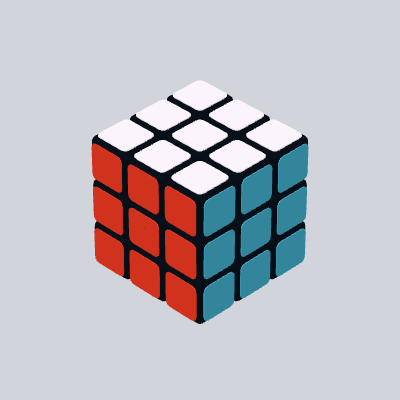
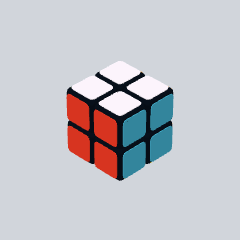
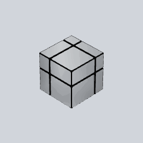
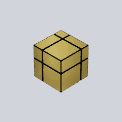
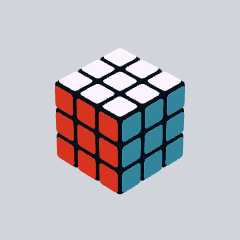
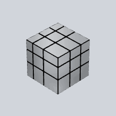
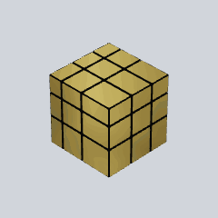
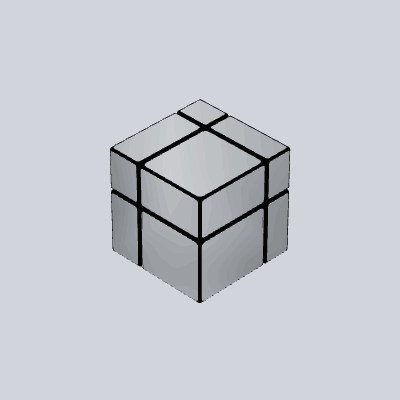

# Git Cube

Your GitHub contributions, expressed through six stages of animated 3D cubes.

[Get the Action on GitHub Marketplace](https://github.com/marketplace/actions/gitcube-contribution-animation).

<picture>
  <source media="(prefers-color-scheme: dark)" srcset="docs/hero-dark.gif">
  
</picture>

**3×3 · advanced** — Y-perm showcase using synthetic activity. Light and dark
backgrounds switch automatically; your own cube follows your contribution totals
and recent commits.

[View the profiles and their activity counts](docs/profiles.md):
`abdulrazzaq27` and `osman-bin-nasir`.

Classic cubes retain rounded pieces, extruded stickers, and the original six
colors. Mirror cubes use unequal blocks with reflective silver or golden metal,
crisp black rims, and studio lighting, changing shape as they turn. GIF
generation runs through the CLI or GitHub Actions, with no website or backend
required.

Each loop starts solved, executes one verified algorithm **twice**, and ends
solved. The second pass repeats the same moves, in the same order. Only
nontrivial algorithms satisfying **A² = Identity** are admitted. No sticker
recoloring, inverse substitutions, or hidden puzzle resets.

## Six stages, one contribution cube

Your rolling 365-day contribution total selects the cube, progressing from classic
2×2 to golden 3×3 mirror. Silver and gold mirrors have unequal blocks,
reflective metal faces, black borders, and studio lighting. Every preview
switches between light and dark backgrounds automatically.

| Stage 1 · 2×2 Rubik’s Cube | Stage 2 · 2×2 silver mirror | Stage 3 · 2×2 golden mirror |
| --- | --- | --- |
| <picture><source media="(prefers-color-scheme: dark)" srcset="https://raw.githubusercontent.com/abdulrazzaq27/GitCube/main/docs/stages/rubiks-2-dark.gif"></picture> | <picture><source media="(prefers-color-scheme: dark)" srcset="https://raw.githubusercontent.com/abdulrazzaq27/GitCube/main/docs/stages/mirror-2-silver-dark.gif"></picture> | <picture><source media="(prefers-color-scheme: dark)" srcset="https://raw.githubusercontent.com/abdulrazzaq27/GitCube/main/docs/stages/mirror-2-gold-dark.gif"></picture> |
| **0–99 yearly contributions** | **100–249 yearly contributions** | **250–499 yearly contributions** |

| Stage 4 · 3×3 Rubik’s Cube | Stage 5 · 3×3 silver mirror | Stage 6 · 3×3 golden mirror |
| --- | --- | --- |
| <picture><source media="(prefers-color-scheme: dark)" srcset="https://raw.githubusercontent.com/abdulrazzaq27/GitCube/main/docs/stages/rubiks-3-dark.gif"></picture> | <picture><source media="(prefers-color-scheme: dark)" srcset="https://raw.githubusercontent.com/abdulrazzaq27/GitCube/main/docs/stages/mirror-3-silver-dark.gif"></picture> | <picture><source media="(prefers-color-scheme: dark)" srcset="https://raw.githubusercontent.com/abdulrazzaq27/GitCube/main/docs/stages/mirror-3-gold-dark.gif"></picture> |
| **500–999 yearly contributions** | **1,000–1,999 yearly contributions** | **2,000+ yearly contributions** |

These gallery animations use synthetic activity with the same low recent
commit count to show each appearance. Your rolling **30-day commits** select
algorithm complexity independently; zero recent commits produces gentle
whole-cube rotation. [View the full progression gallery](docs/progression.md).

## Put your own cube on your profile

1. Create or open your **public profile repository**, named exactly after your
   GitHub username, with a `README.md` in its root. For example,
   `octocat/octocat`. [GitHub’s profile README guide](https://docs.github.com/en/account-and-profile/how-tos/profile-customization/managing-your-profile-readme).
2. Copy [the ready-to-use workflow](examples/profile-workflow.yml) into that
   repository as **`.github/workflows/cube.yml`**. It uses
   `abdulrazzaq27/GitCube@v0.1.0` and selects your username automatically. No fork,
   local installation, or token pasted into a file is required.
3. Add this theme-aware image to your profile `README.md`:

   ```html
   <picture>
     <source media="(prefers-color-scheme: dark)" srcset="assets/git-cube-dark.gif">
     
   </picture>
   ```

4. Commit both files. Open **Actions → Update my Git Cube → Run workflow** for
   the first image. The workflow then regenerates both GIFs every Monday at
   **03:17 UTC / 08:47 IST** and commits changes automatically.

The workflow uses its built-in GitHub token to read yearly profile totals and
recent commit contributions. Yearly progression includes all contribution
types and private activity totals visible on the profile. For authorized
private commits in the 30-day complexity count, optionally add an Actions secret called
`GIT_CUBE_TOKEN` with suitable permissions; GitHub documents `read:user` for
private contributions in this collection. Anonymous private activity is already
included in the yearly calendar total when GitHub exposes it; it is not added
to the recent commit count. Branch protection must allow the workflow’s GIF
commit, or you can publish through your own pull-request workflow.

To display only one theme, use `` for light
or `` for dark. Automatic selection uses
GitHub’s supported [`<picture>` markup](https://docs.github.com/en/get-started/writing-on-github/getting-started-with-writing-and-formatting-on-github/basic-writing-and-formatting-syntax#images).

For **abdulrazzaq27**, the image already generated by this repository can also
be embedded directly in `abdulrazzaq27/abdulrazzaq27`:

```html
<picture>
  <source media="(prefers-color-scheme: dark)" srcset="https://raw.githubusercontent.com/abdulrazzaq27/GitCube/main/assets/abdulrazzaq27-dark.gif">
  
</picture>
```

## Activity → animation

| Stage | Rolling 365-day contributions | Cube |
| --- | ---: | --- |
| 1 | 0–99 | 2×2 Rubik’s Cube |
| 2 | 100–249 | 2×2 Mirror Cube · silver |
| 3 | 250–499 | 2×2 Mirror Cube · golden |
| 4 | 500–999 | 3×3 Rubik’s Cube |
| 5 | 1,000–1,999 | 3×3 Mirror Cube · silver |
| 6 | 2,000+ | 3×3 Mirror Cube · golden |

[See all six animated stages in light and dark mode](docs/progression.md).

| Rolling 30-day commits | Animation complexity |
| ---: | --- |
| 0 | Gentle whole-cube rotation, no face turns |
| 1–29 | Short algorithm |
| 30–99 | Intermediate algorithm |
| 100+ | Advanced, longer algorithm |

Appearance and complexity are independent. A quiet month on an account with
2,000 yearly contributions produces a gently rotating golden 3×3 mirror cube. The
stage is recalculated at each update and can move up or down as the yearly
window rolls. All mirrors use the same verified size-appropriate algorithms.
Thresholds live in [src/config.js](src/config.js): `YEARLY_CONTRIBUTION_THRESHOLDS`
controls the six stages; `COMPLEXITY_THRESHOLDS` controls recent complexity.

| Tier | 2×2 | Moves | 3×3 | Moves |
| --- | --- | ---: | --- | ---: |
| Short (fewer than 30) | Ortega PBL, diagonal / diagonal | 3 | Checkerboard | 6 |
| Intermediate (30–99) | Ortega PBL, adjacent / adjacent | 7 | T-perm | 14 |
| Advanced (100–149) | T-perm, adjacent corners | 14 | Na-perm | 21 |
| Advanced (150 and up) | T-perm, adjacent corners | 14 | Y-perm | 17 |

The 3×3 Advanced tier is split so that both advanced cases are used: Na-perm
animates 100–149 recent commits, and Y-perm takes over at 150. The 2×2 keeps one
case per tier, so `T-perm, adjacent corners` covers both Advanced rows. Each
entry may declare its own exclusive commit ceiling; see
[the algorithm catalog](docs/architecture.md#algorithm-catalog).

**Yearly progression uses the full profile contribution total**, obtained with
GraphQL’s `contributionCalendar.totalContributions`. Commits, issues, pull
requests, reviews, other qualifying activity, and private activity totals
visible on GitHub all count. For example, **817 yearly contributions selects
the normal 3×3**, even if only 359 commit contributions are visible to the token.
GitHub’s calendar already includes visible private activity, so restricted
totals are never added a second time.

**30-day algorithm complexity remains commit-only**, using GraphQL’s
`totalCommitContributions`. Private commits count here only when the token
exposes them as commits; anonymous private activity cannot identify a commit.
See [GitHub’s contribution counting rules](https://docs.github.com/en/account-and-profile/reference/profile-contributions-reference).

Both windows share the same endpoint: the instant of collection, minus exactly
30 and 365 days, respectively. They are not calendar months or calendar years.
Snapshots record these endpoints so an animation can be reproduced offline.
The profile UI may display a different starting day; use identical endpoints
when comparing totals. Version-1 through version-3 snapshots must be recollected.
Version-4 snapshots store `contributions365d` for progression and `commits30d`
for complexity, so older commit-only yearly totals cannot select a lower stage.

## CLI

Requires Node.js 22+ and Chromium:

```sh
npm ci
npx playwright install chromium
```

On Linux, use `npx playwright install --with-deps chromium`. An already installed
Chromium/Chrome can be selected with `GIT_CUBE_BROWSER` set to its executable
path. The original engine’s Three.js r95 is pinned for compatibility; the
renderer uses local scripts and blocks all page network requests.

Authenticate using `gh auth login`, or set `GH_TOKEN` / `GITHUB_TOKEN` in your
shell. A token with suitable access can expose private commit contributions.
Being logged in does not guarantee that permission. Keep tokens out of CLI
arguments and Git history.

```sh
node bin/git-cube.js abdulrazzaq27 --output assets/git-cube.gif
```

By default this writes **both** `assets/git-cube.gif` (light background) and
`assets/git-cube-dark.gif` (dark background) from the same snapshot and exact
move timeline. Classic sticker colors and lighting are preserved; mirror
stages use reflective solid-block materials. Use
`--theme light` or `--theme dark` to write a single theme to the requested path.

If your login is stored in Git Credential Manager instead of `gh`, opt in to
its noninteractive GitHub credential lookup:

```sh
node bin/git-cube.js abdulrazzaq27 --git-credential --output assets/git-cube.gif
```

Collect and reproduce:

```sh
node bin/git-cube.js abdulrazzaq27 --collect-only --snapshot output/activity.json
node bin/git-cube.js --from-snapshot output/activity.json --output output/cube.gif
```

Customize thresholds, output size, or endpoint:

```sh
node bin/git-cube.js abdulrazzaq27 --stage-thresholds 0,100,250,500,1000,2000 --tiers 30,100 --width 400 --fps 25
node bin/git-cube.js abdulrazzaq27 --theme both --output assets/git-cube.gif
node bin/git-cube.js abdulrazzaq27 --as-of 2026-11-03T00:00:00Z
node bin/git-cube.js --help
```

`--stage-thresholds` overrides the six yearly minimums without editing code.
They must be strictly increasing integers starting at zero. The legacy
`--upgrade-at N` option scales all six stages around a 3×3 entry point of N;
it cannot be combined with `--stage-thresholds`.

Generate the configured profiles with a common collection endpoint:

```sh
npm run profiles
# Or reuse an existing Git Credential Manager login:
node scripts/profiles.js --git-credential
# Collect now and render those same snapshots offline:
node scripts/profiles.js --git-credential --collect-only
node scripts/profiles.js --render-only
```

This writes light and `-dark.gif` variants for `assets/abdulrazzaq27.gif` and
`assets/osman-bin-nasir.gif`, plus a [theme-aware gallery with the exact counts
and windows](docs/profiles.md). Mirror stages automatically select metallic
geometry without changing the embed URL. `assets/git-cube.gif` and
`assets/git-cube-dark.gif` are aliases of the primary profile’s variants.

GIF timing uses 20, 25 or 50 fps, which have exact centisecond delays. The
default is 400×400 at 25 fps. Higher tiers contain more moves and produce longer
loops, rather than unrealistically fast turns. A fixed global palette prevents
frame-to-frame color drift. Fixed snapshots and settings produce identical GIF
bytes with the same browser/runtime; cross-platform GPU rasterization may vary.
Failed generation keeps the previous GIF intact.

## Weekly GitHub Action

The included [workflow](.github/workflows/cube.yml) regenerates
the profile GIFs and `docs/profiles.md` every Monday at
**03:17 UTC / 08:47 IST**, and supports a manual run. It commits changed outputs
without rewriting this README.

1. Push this project to your GitHub repository.
2. The workflow uses its built-in token for commit data. Optionally create an
   Actions secret named `GIT_CUBE_TOKEN` with appropriate permissions for
   authorized private commit contributions.
3. Allow the workflow’s `contents: write` permission and run **Update Git Cube**
   once from Actions. Branch protection may require a separate publishing branch
   or a pull request instead of the supplied direct push.

For your own profile repository, follow [the setup steps above](#put-your-own-cube-on-your-profile).
The reusable [composite Action](action.yml) accepts `username`, `output`,
`theme` (`both` by default), `stage-thresholds`, `tiers`, `width`, and `token`.
The legacy `upgrade-at` input remains available for compatibility. Leaving
stage and complexity inputs empty uses the constants in `src/config.js`.
For `theme: both`, it exposes `gif` and `dark-gif` output paths. Its generation
step never commits; the supplied profile workflow commits both images. Use a
published commit SHA instead of the version tag if you want an immutable pin.

The [composite Action](action.yml) generates the image; the calling workflow
commits it. No service account or backend is needed. Scheduled Actions run on
the default branch, can be delayed by GitHub, and may be disabled after 60 days
of inactivity in public repositories; see
[GitHub’s schedule documentation](https://docs.github.com/en/actions/reference/workflows-and-actions/events-that-trigger-workflows#schedule).

## Previews and verification

These previews use **synthetic activity**, not a user’s contribution history:

| 2×2 · intermediate | 3×3 · intermediate&#x20; | No recent contributions |
| --- | --- | --- |
| <picture><source media="(prefers-color-scheme: dark)" srcset="docs/demo-2x2-dark.gif"></picture> | <picture><source media="(prefers-color-scheme: dark)" srcset="docs/demo-3x3-dark.gif"></picture> | <picture><source media="(prefers-color-scheme: dark)" srcset="docs/demo-idle-dark.gif"></picture> |

```sh
npm test
npm run verify
npm run test:render
npm run demo
npm run demo:progression
```

The independent integer model tracks every sticker’s identity, position and
normal. Catalog admission checks `A ≠ Identity` and `A² = Identity`. Rendering
tests compare the original Three.js engine with that model after every turn
of every catalog algorithm. GIF generation repeats this verification, then
checks that its endpoint’s GIF palette pixels equal the first frame before writing any
output. The endpoint is not duplicated in the GIF.

Mirror loops additionally verify the original visible geometry of every block,
not just sticker positions. A local deterministic studio environment supplies
metallic reflections; no external textures or network requests are used. The
first draw is warmed before capture so reflections are stable at the loop seam.

See [architecture](docs/architecture.md), [contributing](CONTRIBUTING.md),
and [license](LICENSE).
