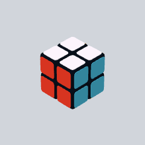
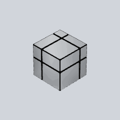
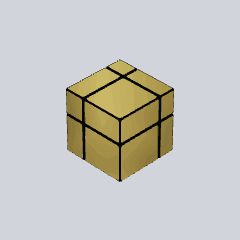
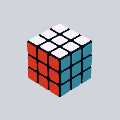
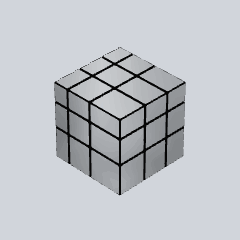
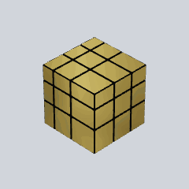

# Six-stage progression

Synthetic examples, with identical low recent activity so appearance can be compared independently of complexity. Each loop executes the same verified order-2 sequence twice.

| Stage | Yearly contributions | Cube |
| --- | ---: | --- |
| 1 | 0–99 | 2×2 Rubik’s Cube |
| 2 | 100–249 | 2×2 Silver Mirror Cube |
| 3 | 250–499 | 2×2 Golden Mirror Cube |
| 4 | 500–999 | 3×3 Rubik’s Cube |
| 5 | 1000–1999 | 3×3 Silver Mirror Cube |
| 6 | 2000+ | 3×3 Golden Mirror Cube |

| 2×2 Rubik’s | 2×2 silver mirror | 2×2 golden mirror |
| --- | --- | --- |
| <picture><source media="(prefers-color-scheme: dark)" srcset="stages/rubiks-2-dark.gif"></picture> | <picture><source media="(prefers-color-scheme: dark)" srcset="stages/mirror-2-silver-dark.gif"></picture> | <picture><source media="(prefers-color-scheme: dark)" srcset="stages/mirror-2-gold-dark.gif"></picture> |

| 3×3 Rubik’s | 3×3 silver mirror | 3×3 golden mirror |
| --- | --- | --- |
| <picture><source media="(prefers-color-scheme: dark)" srcset="stages/rubiks-3-dark.gif"></picture> | <picture><source media="(prefers-color-scheme: dark)" srcset="stages/mirror-3-silver-dark.gif"></picture> | <picture><source media="(prefers-color-scheme: dark)" srcset="stages/mirror-3-gold-dark.gif"></picture> |

Thresholds and mirror offsets are configured in [src/config.js](../src/config.js). The mechanical grid and the original layer-turn engine are shared across all stages. Mirror blocks have unequal extents, a metallic environment-mapped finish, and no visible colored stickers.
